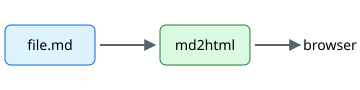

# md2html sample

A tour of what `md2html` renders. Try it: `md2html examples/sample.md`.



## Text

Paragraphs with **bold**, *italic*, ~~strikethrough~~, `inline code`, <kbd>Ctrl</kbd>+<kbd>C</kbd>
and an autolink: https://github.com/andrepiacentini/md2html. Jump to the [tables](#tables)
or read the [usage guide](../docs/usage.md).

> Blockquotes keep their left border.
>
> > And they nest.

## Lists

1. First
2. Second
   - Nested bullet
   - Another one

- [x] Task lists
- [ ] with checkboxes

## Tables

| Feature        | Supported | Notes              |
| :------------- | :-------: | -----------------: |
| Tables         |    yes    |     with alignment |
| Footnotes      |    yes    | like this one[^1]  |

## Code

```python
def greet(name: str) -> str:
    """Say hello."""
    return f"Hello, {name}!"
```

```bash
md2html README.md --save --theme dark
```

## Raw HTML

<p align="center">
  
</p>

<details>
<summary>Collapsible section</summary>

Hidden content, revealed on click.

</details>

---

[^1]: Footnotes are collected at the bottom of the page.
